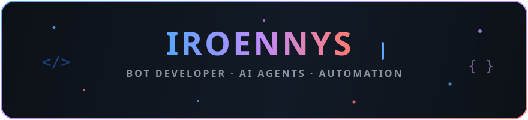

  

<h1 align="center">¡Hola! Soy Iroennys 👋</h1>

  

  <b>Bots · automatización · integraciones de IA</b> 
  Programo en Python y JavaScript, muchas veces desde Termux en Android. 
  Fuera del teclado: gimnasio. La constancia también compila. 💪

  
  

  

## Sobre mí

- 🤖 Creo bots de Telegram y herramientas de automatización.
- 🧠 Me interesan los agentes de IA y las integraciones con APIs.
- 📱 Desarrollo y pruebo proyectos desde Android con Termux.
- 🏋️ Mi otra disciplina es el gimnasio: **constancia > intensidad**.
- 🌱 Aprendo construyendo y compartiendo proyectos.

## Tecnologías

  

  
  
  

## Proyectos

| Proyecto | Qué es |
|---|---|
| [IroS3Dl](https://github.com/juanbas2005/IroS3Dl) | Gestor de descargas Android para S3/ToDus, escrito en Kotlin. |
| [todus-s3-api](https://github.com/juanbas2005/todus-s3-api) | Documentación y ejemplos para la API de ToDus S3. |
| [xkiro-pi-integration](https://github.com/juanbas2005/xkiro-pi-integration) | Integración de Xkiro con pi-coding-agent. |
| [ponytail](https://github.com/juanbas2005/ponytail) | Instrucciones para que un agente de programación trabaje con pragmatismo. |
| [github-console](https://github.com/juanbas2005/github-console) | Terminal web interactiva basada en GitHub Actions. |
| [telegram-s3-cleaner](https://github.com/juanbas2005/telegram-s3-cleaner) | Herramienta para limpiar archivos de Telegram S3. |

## Actividad y estadísticas

  
  

  <picture>
    <source media="(prefers-color-scheme: dark)" srcset="https://raw.githubusercontent.com/juanbas2005/juanbas2005/output/github-contribution-grid-snake-dark.svg" />
    <source media="(prefers-color-scheme: light)" srcset="https://raw.githubusercontent.com/juanbas2005/juanbas2005/output/github-contribution-grid-snake.svg" />
    
  </picture>

## Música para programar

GitHub no permite reproducir audio automáticamente dentro de un README. Pulsa el botón de arriba para abrir una búsqueda de música para programar en YouTube Music.

<i>Un commit a la vez. Una repetición a la vez. 🐎</i>

